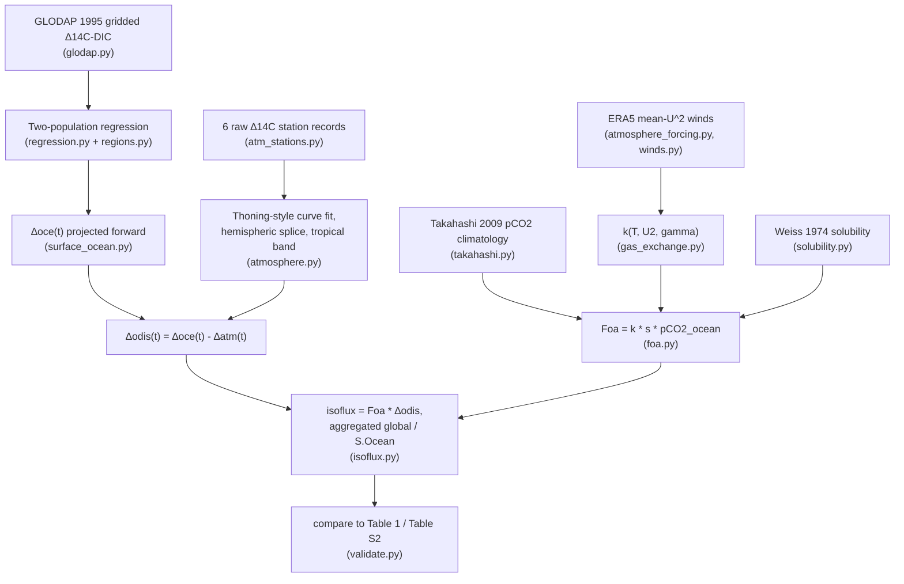

# The Science

This document explains what this code computes, why, and exactly how each
piece of the published method (Miller, Lehman & Lindsay 2025, *Global
Biogeochemical Cycles*, "Numerical representation of contemporary
atmospheric Δ¹⁴CO₂. Part 1") is implemented. It assumes no prior familiarity
with radiocarbon budgeting.

For the original planning document this project was built from (including
the literature-review trail and the reasoning behind every design decision),
see [`CLAUDE.md`](../CLAUDE.md) at the repo root. This document restates the
science in declarative form — what *is*, not what to build — and records
where our implementation ended up relative to that plan's open questions.

## 1. Why this term matters

Atmospheric ¹⁴CO₂ (expressed as Δ¹⁴C, in ‰) is used as a tracer for fossil
fuel emissions, carbon cycle turnover, and other processes. Its global trend
is set by a mass balance of several isotope fluxes: fossil fuel emissions
(¹⁴C-free, strongly negative), cosmogenic and nuclear production (positive),
and the *disequilibrium isofluxes* of the ocean and terrestrial biosphere —
the subject of this repository is the **ocean** term.

Disequilibrium isofluxes exist because gross exchange fluxes between the
atmosphere and a reservoir (ocean or land) are not isotopically identical in
both directions: carbon that left the atmosphere and is now returning has
had time to radioactively decay and mix with older water/carbon, so its
Δ¹⁴C differs from the atmosphere's *current* Δ¹⁴C. That difference, weighted
by the gross one-way flux, is the isoflux.

## 2. The target quantities

```
Δodis(t)   = Δo(t) − Δa(t)                  ocean-atmosphere Δ14C disequilibrium, ‰
Foa(t)     = one-way ocean -> atmosphere CO2 flux, PgC/yr (gross, not net)
isoflux(t) = Foa(t) × Δodis(t)              PgC‰/yr
```

Everything is computed monthly, per 1°×1° ocean grid cell, then summed over
months (annual) and over cells (global, and a Southern Ocean subtotal).

**Validation targets** (Miller et al. 2025, Table 1 / Table S2 — see
[`ocean14c.validate`](../src/ocean14c/validate.py) for the exact numbers):

| Year | Global FoaΔodis (PgC‰/yr) | Global Foa (PgC/yr) | Global Δodis (‰) |
|---|---|---|---|
| 2000 | −3426.6 | 69.1 | −51.4 |
| 2006 | −2278.8 | 71.6 | −32.9 |
| 2012 | −1303.3 | 74.6 | −18.1 |

Sum 2000–2012: **−29,683 PgC‰**. The paper reports a **±20% structural
uncertainty** from the gas-transfer velocity alone — this is the tolerance
band any reproduction, including this one, should be judged against.

## 3. Pipeline overview



## 4. Surface ocean Δ¹⁴C: the empirical Lindsay (2016) method

### 4.1 Starting field

The **GLODAP gridded Δ¹⁴C-DIC climatology** (Key et al. 2004), 1°×1°, is
treated as representative of **1995** conditions:
`ocean14c.glodap.surface_delta_1995()` averages the GLODAP grid over depths
≤50 m (Miller et al. 2025's own definition of "surface").

We do **not** rebuild this field from raw bottle data — the published
regression already expresses the rate of change *as a function of* the 1995
GLODAP value, so only the gridded 1995 field itself is needed (see §4.2).

### 4.2 Two regression populations

Two ocean-region groups, each with its own linear regression of
`dΔ14CDIC/dt [‰/yr]` vs. `Δ14CDIC,1995 [‰]` (`ocean14c.regression`):

| Population | m (yr⁻¹) | b (‰/yr) | Source |
|---|---|---|---|
| Cold/deep ocean (original) | −0.0200 | −3.0851 | SI Fig. S2 |
| Warm ocean (original) | −0.0549 | 2.9832 | SI Fig. S2 |
| Cold/deep ocean (GLODAP v2) | −0.0146 | −3.1359 | SI Fig. S5 |
| Warm ocean (GLODAP v2) | −0.0543 | 2.8324 | SI Fig. S5 |

We use the **original** coefficients by default (`config/default.yaml`,
`regression.coefficients_version: original`) — these match Table 1/S2
exactly. The v2 coefficients are the paper's own documented sensitivity
check (they reduce the 2000–2012 isoflux magnitude change from −62% to
about −59.5%).

**Region masks** (`ocean14c.regions`):
- **Southern Ocean** = dynamically south of the **20‰ isoline** in the 1995
  GLODAP field. This is *not* a fixed latitude — `southern_ocean_mask()`
  floods from the South Pole northward along each longitude column and stops
  at the first crossing above threshold, so an unrelated cold patch further
  north (e.g. equatorial upwelling) is correctly excluded. Missing data
  (ice, land, no bottle samples) doesn't break the flood — only an actual
  value ≥ threshold does.
- **Northern North Pacific**: 32°N west of 149.5°W, 29°N east of it,
  restricted to a North Pacific basin longitude range (a necessary
  implementation choice not given explicitly in the source — see
  `regions.py`'s module docstring — otherwise the naive lat/lon rule would
  leak into the North Atlantic at the same latitudes).
- **cold/deep population** = Southern Ocean ∪ northern North Pacific.
  **warm population** = everywhere else.
- **Drake Passage** is excluded from regression *fitting* (too much
  cross-frontal scatter) — not relevant to v1 since we use the published
  coefficients directly, but the mask is implemented for anyone reproducing
  Fig. S2/S5 from scratch.

### 4.3 Project forward in time

```
Δoce(lat, lon, t) = Δoce_1995(lat, lon) + rate(lat, lon) × (t − 1995.0)
```

`ocean14c.surface_ocean.project_delta_oce()`. Sharp population boundaries
(North Pacific, Southern Ocean) are an accepted artifact, per the SI text.

## 5. Atmospheric Δ¹⁴C field, Δatm(lat, t)

### 5.1 Station curve fitting

Six station records (`ocean14c.atm_stations`, raw data under
`data/raw/Delta_atm/`) are each smoothed with a simplified Thoning et al.
(1989)-style curve — polynomial trend + annual/semiannual harmonics fit by
least squares (`ocean14c.atmosphere.fit_year_edge_values`) — and evaluated
at Jan 1 of each year to get a year-edge value. This is not a full
reimplementation of NOAA's `ccgcrv` (which also low-pass filters the
residual), but it recovers Table 1's own published Δ14CN/Δ14CS series to
within roughly **0.3–3‰/year** across 2000–2012 — see
`docs/USAGE.md` for how to reproduce that check.

### 5.2 Hemispheric splice

`ocean14c.atmosphere.splice_station_series()` picks whichever station's
window covers each year:

| Hemisphere | Station | Window |
|---|---|---|
| N | NWR (Niwot Ridge, CO) | 2004–2012 |
| N | JFJ (Jungfraujoch, CH) | 2000–2003 |
| S | SPO (South Pole) | 1999–2007 |
| S | PSA (Palmer Station, Antarctica) | 2005–2007 |
| S | SMO (American Samoa) | 2001–2007 |
| S | DRP (Drake Passage) | 2006–2012 |

This exact splice (which station covers which years) is what reproduces
Table 1's Δ14CN/Δ14CS; it isn't the only choice consistent with the raw data
(e.g. JFJ's own record runs to 2024), just the one the paper used.

### 5.3 Tropical correction band

```
Δatm(lat, t) = hemispheric_base(lat, t) + (10‰ if band_south <= lat <= band_north else 0)
```

`ocean14c.atmosphere.delta_atm_field()`. Two published choices exist for the
band, both implemented and config-switchable
(`config/default.yaml`, `atmosphere.tropical_band`):

- **`miller`** (default): 10°N–40°S, +10‰ — Miller et al. (2025)'s own
  choice, confirmed against their Fig. 1b (the correction band is visible as
  a sharp boundary in their ocean isoflux map at exactly these latitudes).
- **`basu`**: 20°N–20°S, +10‰ — Basu et al. (2016)'s choice, for
  cross-checking against that paper instead.

### 5.4 Combine

```
Δodis(lat, lon, t) = Δoce(lat, lon, t) − Δatm(lat, t)
```

## 6. Gas-transfer velocity and Foa

### 6.1 Core formula

```
k [cm/hr] = gamma × <U²> × (Sc/660)^-0.5
```

`ocean14c.gas_exchange.transfer_velocity()`. `<U²>` is the **mean of squared**
wind speed (the second moment), not the square of the mean — this
distinction is the crux of §6.3 below.

### 6.2 Schmidt number

Config-switchable polynomial (`config/default.yaml`,
`gas_exchange.schmidt_polynomial`), both for CO₂ in seawater:

- **`1992`** (default): Wanninkhof (1992) Table A1, 3rd-order fit, valid
  0–30°C: `Sc = 2073.1 − 125.62·t + 3.6276·t² − 0.043219·t³`.
- **`2014`**: Wanninkhof (2014) Table 1, quartic fit, valid −2 to 40°C:
  `Sc = 2116.8 − 136.25·t + 4.7353·t² − 0.092307·t³ + 0.0007555·t⁴`
  (`Sc(20°C) = 668`, the number both fits should agree closely on).

### 6.3 The gamma calibration constant, resolved as far as the literature allows

The leading coefficient in the k formula is not universal — it's fit to the
global bomb-¹⁴C inventory for whatever wind product is being used, because
different wind products have different statistical moments (Sweeney et al.
2007; Wanninkhof 1992, 2014). Reading **Wanninkhof (1992)** directly (the
paper Miller et al. 2025 actually cite for their functional form — not
Wanninkhof 2014, contrary to what a first read of the Miller paper's methods
paragraph might suggest) gives two coefficients, calibrated for two
different wind-averaging conventions:

- Eq. (1): `k_av = 0.39 × (U_avg)² × (Sc/660)^-0.5` — for **long-term
  averaged** wind speed (the square of the mean).
- Eq. (3): `k = 0.31 × U² × (Sc/660)^-0.5` — for **steady/short-term** wind
  speed, i.e. the true second moment `<U²>`, derived by deconvolving the same
  bomb-¹⁴C constraint through a Rayleigh wind-speed distribution.

`ocean14c.atmosphere_forcing` computes `<U²>` correctly (mean of squared
6-hourly instantaneous wind), so the structurally correct default is
**γ = 0.31** (`gas_exchange.DEFAULT_GAMMA`) — not Wanninkhof 2014's 0.251
(calibrated for a different wind product's moments) and not 1992's 0.39
(calibrated for the wrong moment entirely).

This resolves *which coefficient goes with which wind statistic* but not
the full open issue: Miller et al. (2025) state they further rescaled this
constant "using the scaling factor appropriate for ERA-Interim winds," and
that exact rescaling factor is not published anywhere available to this
project. As a pragmatic stand-in, `ocean14c.validate.fit_gamma()` refits γ
by minimizing squared error against Table S2's **Global_Foa** series (an
independent target — it depends only on `k` and `pCO2_ocean`, not on Δodis
at all) once real ERA5 wind data is available. Both 0.31 and any refit value
are expected to sit within the paper's own acknowledged ±20% uncertainty.

### 6.4 Solubility

Weiss (1974) CO₂ solubility (`ocean14c.solubility.co2_solubility()`):

```
ln(K0) = A1 + A2·(100/T) + A3·ln(T/100) + S·[B1 + B2·(T/100) + B3·(T/100)²]
```

with `A1=-60.2409, A2=93.4517, A3=23.3585, B1=0.023517, B2=-0.023656,
B3=0.0047036`, `T` in Kelvin, `S` in psu, `K0` in mol/(L·atm). These
coefficients — not detailed anywhere in the Miller 2025 paper or SI — were
sourced from **Wanninkhof (1992) Table A2**, which also states (main text)
that this fit gives `K0 = 0.0324 mol/(L·atm)` at 20°C; that's the anchor
value `test_solubility.py` checks against.

### 6.5 pCO2 ocean climatology and drift

Monthly climatology from Takahashi et al. (2009) (`ocean14c.takahashi`,
raw data `data/raw/Takahashi2009/month_flux_2006c.txt`, native 4°×5° grid,
nearest-neighbor regridded to 1°×1°), referenced to year 2000, drifted
forward at the file's own **+1.5 μatm/yr** rate (matching CLAUDE.md and the
Miller 2025 text exactly — the raw file's header documents the same drift
rate independently).

### 6.6 Foa itself

Following the standard isotope mass-balance convention (Tans 1980):

```
Foa = k × s × pCO2_ocean      (one-way, ocean side only)
Fao = k × s × pCO2_atm        (the other one-way component; not needed here)
```

`ocean14c.foa.compute_foa()` and `foa_flux()` handle the unit chain
(cm/hr → m/yr, mol/(L·atm) → mol/(m³·atm), μatm → atm) explicitly — see the
module for the exact conversion constants.

## 7. Combine and aggregate

```
isoflux(lat, lon, t) = Foa(lat, lon, t) × Δodis(lat, lon, t)     PgC‰/month, per cell
```

`ocean14c.isoflux.compute_isoflux()`, then:
- **`spatial_sum()`**: straight sum over cells (optionally masked) — this is
  how **Table 1** is built (sum of the actual gridded monthly product).
- **`flux_weighted_mean()`**: `sum(Foa·Δodis)/sum(Foa)` — this is how
  **Table S2**'s reported Δodis means are computed (a flux-weighted spatial +
  temporal mean, *not* the same operation as Table 1's straight sum). Table
  S2's `Global_Foa × Global_Δodis` will therefore **not** exactly equal
  Table 1's `FoaΔodis` for the same year — that's expected, not a bug; the
  two tables use different aggregators, per the SI's own note.

## 8. Validation results

`ocean14c.pipeline.reconstruct_year()` has been run for real against **the
full 2000–2012 series** (real GLODAP, Takahashi, all six Δ¹⁴C stations, and
real downloaded-and-processed ERA5 winds for every year — see
`docs/USAGE.md` and `scripts/validate_full_series.py`, which produces the
table and figures below in one run).

**Single-year snapshot (2006), default γ=0.31 (Wanninkhof 1992 Eq. 3):**

| Quantity | Computed | Target | % error |
|---|---|---|---|
| Global FoaΔodis (PgC‰/yr) | −2880.4 | −2278.8 (Table 1) | +26.4% |
| Global Foa (PgC/yr) | 103.4 | 71.6 (Table S2) | +44.4% |
| Global Δodis (‰) | −27.9 | −32.9 (Table S2) | −15.3% |
| S.Ocean Foa (PgC/yr) | 24.2 | 22.3 (Table S2) | +8.4% |
| S.Ocean Δodis (‰) | −103.6 | −97.3 (Table S2) | +6.5% |
| Spatial correlation vs. `Ocediseq.nc` | **0.916** | 1.0 | — |

**Full 13-year series, γ refit against Table S2's Global_Foa across all 13
years** (`validate.fit_gamma()`, not just the single-year fit): **γ=0.2147**
— consistent to four significant figures with the single-year-2006 fit,
which is itself a good sign the calibration constant is genuinely stable
across the period rather than an artifact of one year. With that γ:

| Quantity | Computed | Target |
|---|---|---|
| SUM 2000–2012 (PgC‰) | **−26,179** | −29,683 (Table 1's `SUM` row) — **−11.8%** |
| Mean spatial correlation vs. `Ocediseq.nc` (13 years) | **0.913** | 1.0 |
| Per-year FoaΔodis error range | −10.3% to −13.8% | within the paper's own ±20% |

The per-year error is remarkably stable across the whole period (not
drifting worse toward either end of 2000–2012), and the spatial correlation
is equally stable (0.90–0.93 every year — see
`results/figures/temporal_comparison.png`, bottom panel). The default-γ SUM
(without refitting) is −37,800 PgC‰, +27.3% high — consistent with the
single-year 2006 result, confirming γ is the dominant remaining source of
aggregate-magnitude error, not something that only shows up in one year.
Full per-year numbers: `results/full_series_results.csv` (fitted γ) and
`results/full_series_results_default_gamma.csv` (default γ).

**Spatial pattern** (`results/figures/spatial_comparison.png`, 2000/2006/2012):
visually, the reconstruction and `Ocediseq.nc` are close to indistinguishable
at the ocean-basin scale — same Southern Ocean and North Pacific low-Δ¹⁴C
bands, same low-latitude structure. The difference maps show the
disagreement is **not spatially random**: it concentrates in a narrow band
right at the Southern Ocean's poleward edge (the reconstruction is
consistently *less negative* than `Ocediseq.nc` there), consistent across
all three plotted years. That's a specific, actionable lead for anyone
tightening this further — most likely the dynamic 20‰-isoline boundary
(`regions.southern_ocean_mask()`) or Drake Passage handling differing
slightly from the paper's own implementation, rather than a diffuse,
unstructured error.

The **spatial correlation is scale-invariant** — it doesn't change with γ,
since γ is a uniform multiplicative constant. It's the more fundamental
check that the *pattern* of the reconstruction (not just its global
magnitude) is right, and ~0.91 against the paper's own published product,
every year, from a fully independent reconstruction, is a strong result.

**A real bug was caught by this end-to-end test, not by any per-module unit
test.** `takahashi.regrid_nearest()` originally used a naive
nearest-neighbor interpolation (`DataArray.interp(method="nearest")`) to go
from Takahashi's coarse 4°×5° grid to the target 1°×1° grid. Wherever a
1°×1° ocean cell's geometrically nearest 4°×5° grid center happened to be a
native land/no-data point, the result was `NaN` — silently dropping that
cell from every downstream sum. Measured against the real data: **62% of
GLODAP's ocean-cell area** was going `NaN` this way before the fix, which
by itself roughly explains the initial factor-of-~2 shortfall in computed
Foa. The fix (`regrid_nearest` now excludes `NaN` native cells from the
nearest-neighbor search via a `scipy.spatial.cKDTree` over valid points
only) is covered by `test_regrid_nearest_skips_nan_native_cells` and
`test_regrid_nearest_skips_nan_across_a_month_dimension` in
`tests/test_takahashi.py`. A related class of bug (`foa.py` and
`solubility.py` calling `np.asarray()` on their inputs, silently stripping
`xarray` dimension/coordinate metadata and falling back to fragile
positional-not-named broadcasting) was caught the same way and is covered
by `test_foa_flux_preserves_xarray_dims_and_broadcasts_by_name_not_position`
and `test_co2_solubility_preserves_xarray_dims`. Both are exactly the kind
of bug small synthetic per-module test fixtures don't exercise — real,
differently-shaped, differently-ordered `xarray` grids from independent
data sources are what surfaces them.

### 8.1 Independent test against GLODAPv2.2020 repeat sections

Everything above validates against Miller et al. (2025)'s own products —
i.e. against the same paper the regression coefficients came from.
`scripts/compare_glodap_trends.py` adds a genuinely independent test of
§4.2–4.3, the step that carries the most weight: it compares the projected
surface Δ¹⁴C trend against discrete bottle Δ¹⁴C from GLODAPv2.2020 along the
A16 and P16 repeat sections, binned by 2° latitude following Pookkandy,
Graven & Martin (2023, *Clim Dyn* 61:3223–3235), whose NEMO "Hist" run is
carried alongside as a second independent estimate.

Run (`--depth-max 200`, 1544 bottles, 36 cruises, 55 usable bins):

| Region (P16) | bins | bias | RMSE | r |
|---|---|---|---|---|
| **Warm population, −45°…+30°** | 32 | **+1.8** | **8.6** | +0.41 |
| Northern N. Pacific (cold pop, >30°N) | 12 | **−21.3** | 22.0 | +0.34 |
| S. Ocean boundary (−58°…−45°) | 5 | −2.7 | 19.5 | −0.50 |
| All | 52 | −4.3 | 14.0 | +0.29 |

(‰/decade. Global median trend: observed −21.3, this repo −21.3 — the
overall calibration is right.)

**Three findings.**

1. **The warm population is well validated.** Bias +1.8 ‰/decade and RMSE
   8.6 over 32 bins spanning −45° to +30°, against data that had no role in
   fitting the coefficients.

2. **The northern North Pacific is badly over-predicted** — a factor of
   ~2. Observed is a remarkably flat −15 to −28 ‰/decade across 33–57°N
   (16–81 bottles/bin, 3–5 cruises, 1σ of 1.4–6.8), while the cold
   coefficients give −36 to −51. Pookkandy's NEMO run independently returns
   −24 to −25 there, agreeing with the observations, so this is very
   unlikely to be an artifact of the observations.

   Reassigning the region to the *warm* population does **not** fix it: warm
   fits at 33–37°N but gives the wrong sign (up to +16 ‰/decade) north of
   45°N. The deeper issue is that the observed rate is nearly independent of
   Δ¹⁴C₁₉₉₅ there (fitted slope −0.0040 vs −0.0200 published for cold),
   even though Δ¹⁴C₁₉₉₅ ranges over 25–103‰ across those bins — so the
   linear-in-Δ¹⁴C₁₉₉₅ *form* is what breaks down, not just the coefficient
   choice. Caveat: a single meridional line at 150°W, over a narrower
   Δ¹⁴C₁₉₉₅ range than the published global fits used, so the attenuated
   slope is partly expected; this indicates a problem, it does not by itself
   re-derive the coefficients.

3. **The circulation-variability hypothesis gets only weak support.**
   Correlating |this repo − observed| against the circulation-driven
   σ(Δ¹⁴C) from NEMO Hist − Hist_NYF gives r = +0.31 (n = 55) — positive,
   as anticipated, but weak, and confounded with
   finding 2 since the largest residuals sit in the North Pacific.

Figures: `results/figures/glodap_{trend_vs_latitude,trend_scatter,circulation_test}_{30,200}m.png`.
Per-bin numbers: `results/glodap_trend_comparison_{30,200}m.csv`.

**Caveats.** GLODAP `G2c14` is not secondary-quality-controlled (it carries
`G2c14f` and `G2c14err` but no `G2c14qc`), so inter-cruise offsets are
uncorrected — though all 40,797 values carry flag 2. A16 has no North
Atlantic coverage after the 1990s (a real observational gap, noted by
Pookkandy too), leaving only 3 usable A16 bins; P16 carries the result. The
NEMO run is biased low by >20‰ in the interior and underestimates decadal
change by ~5‰/decade, so it is corroboration, not a truth standard.

### 8.2 The northern North Pacific correction

§8.1's P16 result was one meridional line. `scripts/refit_regression_glodap.py`
widens it to every GLODAPv2.2020 bottle, binning into 4° boxes (≥6 samples,
≥12 yr span, ≥2 cruises) and refitting rate vs Δ¹⁴C₁₉₉₅ per population —
the same construction as SI Fig. S2, with newer, independent observations.

**The control that makes this trustworthy** (155 boxes, 92 cruises,
≤200 m, 1990–2018), published coefficients vs GLODAP observations:

| population | n | bias | RMSE | Δ¹⁴C₁₉₉₅ span |
|---|---|---|---|---|
| warm | 100 | **+2.6** | 11.9 | 95‰ |
| Southern Ocean | 31 | −11.7 | 16.6 | 108‰ |
| **N. North Pacific** | 24 | **−23.2** | 24.6 | 117‰ |

The published **warm** coefficients validate cleanly against data that had
no role in fitting them, so the method is sound; and the North Pacific has
the *widest* Δ¹⁴C₁₉₉₅ span, so restricted-range attenuation cannot explain
its bias. Pookkandy et al. (2023)'s NEMO run independently returns −24 to
−25 ‰/decade there, agreeing with the observations against the published
cold line's −36 to −51.

Refit for the northern North Pacific: **rate = −0.0148·Δ¹⁴C₁₉₉₅ − 1.1320**,
which reduces bias from −23.2 to 0.0 and RMSE from 24.6 to 8.0 ‰/decade.
Available as `regression.coefficients_version: glodap2020_npac`, which keeps
`original`'s cold and warm coefficients untouched and adds the third
population only.

**It is not the default, deliberately.** Applying it moves the reconstruction
*away* from Miller et al. (2025):

| | SUM 2000–2012 | vs Table 1 | mean spatial r |
|---|---|---|---|
| `original` (default) | −26,179 PgC‰ | −11.8% | 0.913 |
| `glodap2020_npac` | −24,735 PgC‰ | −16.7% | 0.903 |

The shift is +1,444 PgC‰ (5.5% of the total) and grows monotonically with
time — 1.7% in 2000 to 15.6% in 2012 — exactly the signature of a rate error
accumulating linearly from the 1995 reference year.

That divergence is the expected consequence, not a refutation. Miller et al.
use the same published cold coefficients, so their product should carry the
same North Pacific bias; correcting it *must* move away from their numbers.
The uncomfortable implication is that part of this repo's −11.8% agreement
with Table 1 may rest on reproducing a shared error rather than on being
right. Reproducing Table 1 and matching the observations are, in this
region, competing objectives — hence the toggle, with `original` kept as the
default because reproducing Table 1/S2 remains the project's stated primary
target.

**Limits of the refit.** The slope is likely attenuated by
errors-in-variables (Δ¹⁴C₁₉₉₅ carries its own uncertainty): the same
procedure applied to the warm population returns −0.0246 against a published
−0.0549, despite the warm *predictions* being nearly unbiased. The robust,
NEMO-corroborated part of the correction is therefore the intercept offset
(~+2 ‰/yr), not the precise slope. The Southern Ocean shows a smaller
(−11.7) bias of the same sign and is left alone for now — 31 boxes over a
region with known strong circulation-driven variability, and correcting it
would compound the divergence above without comparable corroboration.

### 8.3 The Table 1-matched flux variant

Everything above measures how far the reconstruction sits from Miller et al.
(2025). `ocean14c.table1` offers the other option: a TM5-facing flux product
that simply *is* Table 1, obtained by multiplying each year's field by one
scalar,

    factor(year) = Table_1(year) / global_isoflux(year)

so the annual global isoflux matches to machine precision (verified on the
written NetCDF files: worst residual **0.023 ppm** of the target across
2000–2012, against float32's own 0.119 ppm storage precision — i.e. the only
thing separating the product from Table 1 is how the file stores it). It is
written as `flux_c14.ocedis_table1.<year>.nc`, beside — never over — the
reconstruction, by `scripts/validate_full_series.py --flux-variant table1|both`.

`scripts/plot_flux_variants.py` produces the three figures behind the claims in
this section, from the shipped files:
`results/figures/flux_variants_{temporal,spatial,pointwise}.png`.

**What it changes: the amplitude, and nothing else.** One scalar per year
leaves the spatial pattern, the seasonal cycle and the sign of every cell
untouched, so the spatial correlation against `Ocediseq.nc` (0.90–0.93) is
bit-for-bit unchanged, and so is the sign change in the early 2020s (§9).
Measured on the 2011 files: slope of variant against reconstruction through the
origin **1.109256** over all 399,492 ocean cells × months, against a fitted
factor of 1.1093, and the pointwise ratio spreads over **0.2 ppm** — three
spikes one float32 ulp apart, which is the product rounding and nothing else
(`flux_variants_pointwise.png`).
This is the same operation as changing γ, which enters `k` as a uniform
multiplicative constant (§6.3) — the variant is exactly what a γ recalibrated
per year against Table 1 would have produced, instead of the single γ=0.2147
refit against Table S2's Foa.

**Factors, from full 2000–2012 runs at γ=0.2147:**

| | `--curve-fit simplified` | `--curve-fit ccgcrv` |
|---|---|---|
| SUM (PgC‰) | −26,179 (−11.8%) | −26,271 (−11.5%) |
| range | 1.114 (2008) – 1.160 (2011) | 1.084 (2009) – 1.167 (2005) |
| mean / sd | 1.1349 / 0.0135 | 1.1271 / 0.0256 |
| trend with year | +0.0011/yr, p=0.32 | −0.0032/yr, p=0.09 |
| sum-matching factor | 1.1338 (0.1% off the mean) | 1.1299 (0.3% off) |

Neither trend is significant, so years outside Table 1's window (2013–2025)
take the mean, giving a ~2% step at the 2012/2013 boundary — smaller than the
spread inside the window. The factors are recomputed live from whatever
settings the run uses, so changing γ, the regression version or the curve fit
does not silently invalidate them; the frozen tables in `ocean14c.table1` are
only a fallback for runs containing no year Table 1 covers, and the script
warns when one is used. They are keyed by curve fit because the choice moves a
single year's factor by up to 4.6% (2011: 1.1598 vs 1.1093) — more than the
spread within either series. Note that `ccgcrv` is what produced
`results/full_series_results.csv` and the shipped
`output/flux_c14.ocedis.<year>.nc`, while `simplified` is the script default.

**When to use which.** `reconstruction` answers "what does the raw data say",
and is the right input for anything that tests this pipeline. `table1` answers
"what would TM5 do driven by the published ocean term", and is the right input
when the atmospheric Δ¹⁴C budget must close against Miller et al.'s numbers
rather than against ours — the ~13% is a large, systematic term in that budget.

**What it is not.** It does not close the gap in §8–8.2; it asserts it away.
§8.2 in particular is a warning against reading agreement with Table 1 as
correctness: correcting the independently corroborated northern North Pacific
bias moves the total *away* from Table 1 (−11.8% → −16.7%), so the ~13% this
variant multiplies in may partly be a bias Miller et al. and this repo share.
A `table1` field must never be presented as an independent reconstruction, and
`--regression-version glodap2020_npac --flux-variant table1` in particular is
close to self-defeating: it corrects the North Pacific and then rescales the
correction back out of the global total.

## 9. Extending beyond 2012

The reconstruction was built to reproduce Miller et al. (2025), whose
validation window is 2000–2012. Everything needed to run past that was
already in place except the atmospheric station windows, which stopped at
2012 and raised `StopIteration` for later years. `ocean14c.atmosphere` now
carries windows through 2030 and the pipeline runs **2000–2025**.

**What did and did not need changing.** ERA5 `<U²>` is processed for every
year to 2025. The Takahashi pCO₂ climatology plus its +1.5 µatm/yr drift
(§6.5) and the Δoce projection from 1995 (§4.3) are both analytic in time and
extend without modification. Only Δatm needed work.

**Station splicing.** Windows may now list a station in two separate periods,
so one record can serve early and late years. The governing rule is that a
station is never asked for months past its last observation, because the
curve fit (§5.1) is a global quadratic and extrapolates poorly:

| station | record ends | last fully-covered year | used for |
|---|---|---|---|
| JFJ | 2024.33 | 2023 | 2000–2003, 2021–2025 |
| NWR | 2021.40 | 2020 | 2004–2020 |
| SPO | 2024.00 | 2023 | 1999–2007, 2017–2025 |
| DRP | 2016.96 | 2016 | 2008–2016 |
| SMO, PSA | 2023.95 / 2007.69 | 2022 / 2006 | unused after 2007 |

**2000–2012 station selection is unchanged** — JFJ→NWR in the NH, SPO→DRP in
the SH — and is locked by
`test_station_selection_for_the_validation_window_is_unchanged`. The full-run
numbers are bit-for-bit identical: SUM −26,179 PgC‰, −11.8%, mean spatial
correlation 0.913.

The two new splices are benign. NWR→JFJ (2021) is near-seamless: the two
agree to **−0.08‰** (sd 1.23) over 19 overlapping years. DRP→SPO (2017)
carries a ~1.3‰ step, within the ~2‰ spread among SH stations. Both show up
as year-on-year changes of −35 and −53 PgC‰ against a non-splice median of
+115 (sd 83) — about 2σ, visible but not dominant.

**Extrapolation flag.** `reconstruct_year()` returns `atm_station_nh`,
`atm_station_sh`, and `atm_extrapolation_yr` — how far past the last
observation that year's December midpoint falls. It is 0.0 through **2023**;
2024 and 2025 extrapolate by 1.0 and 2.0 years respectively and should be
treated as provisional. The columns are carried into
`results/full_series_results.csv`.

### The isoflux changes sign in the early 2020s

The headline result of the extension: the global ocean disequilibrium
isoflux crosses zero between **2023 and 2024**.

| year | global FoaΔodis | global Δodis | S. Ocean Δodis |
|---|---|---|---|
| 2012 | −1124 | −15.2‰ | −94.7‰ |
| 2020 | −162 | −2.1‰ | −86.7‰ |
| 2023 | −63 | −0.8‰ | −86.2‰ |
| 2024 | **+42** | +0.5‰ | −85.2‰ |
| 2025 | **+139** | +1.8‰ | −84.7‰ |

The mechanism is straightforward: Δatm is falling faster (fossil dilution)
than Δoce, so Δodis = Δoce − Δatm rises toward and through zero. The Southern
Ocean stays strongly negative throughout (−85‰), so this is the tropical and
subtropical outgassing region growing until it outweighs the Southern Ocean
sink in the global integral — exactly the picture Pookkandy, Graven & Martin
(2023) describe independently from a NEMO simulation ("the net air-sea flux
changed its sign to negative in the low latitudes by the mid-1990s… the area
of ¹⁴C outgassing extends progressively poleward with time. However, the
Southern Ocean remains a strong sink").

**For a TM5 long run this matters**: the ocean term stops being a ¹⁴C sink
and becomes a source partway through the period, so any configuration that
assumes a fixed sign will be wrong after ~2023.

Two independent reasons the crossing may be **earlier** than 2024, not later:

1. The quadratic curve fit appears to under-estimate the recent acceleration
   of the Δatm decline (extrapolating NWR gives −3.6‰/yr, JFJ −2.0‰/yr,
   against an observed recent rate nearer −4 to −5‰/yr). Under-estimating the
   Δatm decline makes Δodis too *negative*.
2. §8.2's GLODAP test shows the published regression over-predicts the Δoce
   decline (badly in the North Pacific), which also makes Δodis too negative.
   Running with `--regression-version glodap2020_npac` moves the whole series
   upward and brings the crossing forward.

Both error directions push the same way, so 2023–2024 should be read as an
upper bound on the crossing year rather than a best estimate.

## 10. Gridded atmospheric Δ¹⁴C (Δatm) for TM5

A separate product from the ocean isoflux, built in this repo because it reuses
the same station readers. TM5's radio_co2 setup needs an atmospheric Δ¹⁴C
forcing; Basu et al. (2016) take it from a **single background station**, and
Graven et al. (2020)'s CMIP6 forcing resolves only **three zonal bands**,
annually. This produces a **monthly, gridded** field with an uncertainty
estimate, from the full 22-station network.

Build with `scripts/build_delta_atm_grid.py`, validate with
`scripts/validate_delta_atm_grid.py`.

### 10.1 Method

Time and space are handled separately, which is what keeps the spatial step
replaceable by the planned optimal-interpolation scheme:

1. **Registry** (`stations.py`) — coordinates parsed from each `.c14` header,
   so adding a station means dropping in its file. Files sharing a station code
   are merged (ALT, and JFJ where the ICOS 2026 release extends the record).
2. **Background filter** (`background.py`) — see §10.2.
3. **Curve fit** (`curvefit.py`) — one `ccgFilter` per station (NOAA ccgcrv,
   vendored under `vendor/`), giving a continuous curve evaluable at any month.
   Harmonics reduced from NOAA's default 4 to 2: Δ¹⁴C records are ~25
   samples/yr, and 4 harmonics chase noise at that density.
4. **Kriging** (`krige.py`) — universal kriging with a sin(latitude) drift,
   **one month at a time**. Because step 3 already handles time, each month is
   an independent ≤22-point problem, solved directly with numpy. No kriging
   dependency.

### 10.2 Why a background field

TM5 already simulates fossil dilution through `CO2_ff × fossil_del = −1.0`. A
Δatm carrying local fossil depletion would count that dilution **twice** in the
C_D14C budget, so the forcing must represent well-mixed air.

Two filters. A small hand-set list of sites with dominant local fossil
influence (MWO above the Los Angeles basin; CMA and NHA in US eastern-seaboard
outflow), and an **iterative one-sided outlier rejection**: fossil CO₂ is
¹⁴C-free, so contamination can only push Δ¹⁴C *down*, and rejecting only the
negative tail removes pollution events while leaving genuine high-side
variability intact.

The scale for that test is estimated from the **positive residuals only**
(`positive_side_scale`). Estimating σ from all residuals and iterating is the
classic sigma-clipping runaway — each rejection shrinks σ, which rejects more —
and it drove 8–16% rejection at remote sites like KUM and MLO, far too much for
genuine pollution. The positive half is uncontaminated by construction, and for
a symmetric distribution its RMS estimates σ directly. With that fix, rejection
falls to **0–2.3%** and every station converges.

**Known limitation:** ccgcrv absorbs a *persistent* offset into the fitted
curve, so the statistical filter catches episodic spikes but not a steady
regional bias. The site classification is doing the real work for MWO/CMA/NHA,
and those sites are excluded by default (retained and downweighted with
`--include-regional`).

### 10.3 What the network can actually resolve

This is the central result, and it is a negative one. Leave-one-station-out
cross-validation, 1990–2023, background stations:

| predictor | LOO RMSE (‰) |
|---|---|
| global mean (no spatial structure) | 3.570 |
| latitude-band mean (±20°) | 3.394 |
| **drift only, sin(lat) degree 1** | **2.921** |
| drift only, sin(lat) degree 2 | 3.077 |
| drift only, sin(lat) degree 3 | 3.746 |
| universal kriging (shipped) | 2.918 |

**The network supports a linear interhemispheric gradient and essentially
nothing more.** Residual kriging improves RMSE by 0.1%, and the RMSE surface is
flat to within 1% across a 200× range of correlation lengths — neither
longitudinal structure nor meridional curvature is resolvable. Degree 2 is
measurably *worse* than degree 1.

That is not a defect of the method but of the sampling: longitudes cluster in
North America and Western Europe, with nothing over Asia or Africa, and after
background filtering the remaining zonal differences are at the noise level.
**The shipped field is therefore close to zonally uniform — by measurement,
not by assumption.** It is still a real advance on Graven's three bands:
continuous in latitude, monthly rather than annual, and with an uncertainty
field.

The kriging machinery is kept regardless, because it produces that uncertainty
field (a bare least-squares fit does not) and because it is the natural slot
for the planned optimal interpolation, which will bring transport information
the current network lacks.

One further finding worth not re-discovering: the kriging observation error
must be a **spatial representativeness** error, not the scatter of a station
about its own curve. Weighting by curve scatter over-weights stations whose
records happen to be smooth (SMO, MLO, SPO at ~1‰) and pushed LOO RMSE from
2.921 to 3.105.

### 10.4 Validation against Graven et al. (2020)

Averaging the gridded field into Graven's three sectors, 1990–2015 (n=26):

| sector | bias (‰) | RMSE (‰) |
|---|---|---|
| NH (30–90°N) | −0.36 | 1.21 |
| Tropics (30°S–30°N) | −1.83 | 2.42 |
| SH (90–30°S) | +1.34 | 1.70 |

Interhemispheric gradient (NH−SH, 2010+): **−6.2‰**, against Graven's ≈−3.2‰.
Ours is the closer match to the raw station differences, which give NWR−SPO
= −6.56‰ and JFJ−SPO = −5.57‰ over 19–25 overlapping years — i.e. computed
directly from observations, with no interpolation involved.

> Graven's time axis is annual **midpoints** (1850.5 … 2015.5). Matching a
> calendar year to the nearest point compares against the previous year, which
> at ~5‰/yr of decline shows up as a spurious −6‰ bias. `fig_graven` matches
> `gt == y + 0.5` explicitly.

### 10.5 Coverage, and where it stops

Complete for **1990–2022**; 2023 is gridded for January–November only.

The product stops there because the network does, not because of any choice
here. By 2023 only ALT, ATO, IZO, JFJ, MLO, NMY, SMO and SPO still report, and
through 2024–2025 **only JFJ** — a single Northern Hemisphere site, from which
no gradient (let alone a field) can be constrained. Months with fewer than
`MIN_STATIONS = 4` contributors are written as NaN and excluded from the
scalar timeseries.

> A bug worth remembering: `np.nansum` of an all-NaN slice returns **0.0**, not
> NaN. An earlier version used it in `zonal_band_mean` and wrote Δ¹⁴C = 0.000‰
> into the TM5 timeseries for all of 2024–2025 — a silently wrong forcing
> rather than an obviously missing one. Pinned by
> `test_zonal_band_mean_returns_nan_for_an_all_nan_month`.

### 10.6 Output

```
output/d14c_atm.<year>.nc        d14c(time, lat, lon)              [permil]
                                 d14c_uncertainty(time, lat, lon)  [permil]
                                 n_stations(time)
output/d14c_atm_timeseries.nc    scalar Delta14C(year, month), dimensionless
```

The timeseries is written in the exact format
`tm5.radiocarbon_emissions.prepare_atmos_del_timeseries()` produces — value as
the **dimensionless fraction** (permil/1000) TM5's Fortran expects — so the
existing scalar workflow keeps working untouched.

Using the *gridded* field in TM5 needs a Fortran change: `emission_fwd.F90:360`
does `atmos_del(year)%del(month) * sum(emis_nat(:,i,j))`, so `atmos_del` would
gain `(i,j)` along with its NetCDF read. The adjoint is unaffected (fixed
forcing, not a control variable). Deliberately out of scope for now.

## 11. The ccgcrv curve fit, and extrapolating to 2024–2025

`atmosphere.fit_year_edge_values` now takes a `method` argument:

* `"simplified"` (**default**) — polynomial + harmonics by least squares, the
  original implementation.
* `"ccgcrv"` — NOAA's own method (Thoning et al. 1989), which the source papers
  actually cite. Adds the low-pass-filtered residual the simplified fit omits,
  and can extrapolate past the end of a record.

The default stays `simplified` because the validated 2000–2012 reproduction was
established with it. `reconstruct_year(..., curve_fit="ccgcrv")` and
`validate_full_series.py --curve-fit ccgcrv` select the alternative.

### 11.1 Effect on the validated period

| | SUM 2000–2012 | vs Table 1 | mean spatial r |
|---|---|---|---|
| `simplified` | −26,179 PgC‰ | −11.8% | 0.913 |
| `ccgcrv` | −26,271 PgC‰ | **−11.5%** | 0.913 |

A slight improvement, in the right direction, from the method the papers
describe. Per-year differences are ±70 PgC‰ (2–4%) with no systematic drift,
and the spatial correlation is unchanged, which settles that question,
though it is clearly not the main lever on the remaining gap.

### 11.2 How extrapolation works, and what it costs

`getSmoothValue` returns **NaN** outside a record, so extrapolation needs an
explicit rule. `curvefit.StationFit.extrapolate` continues the deseasonalised
trend at its end-of-record growth rate and adds the fitted seasonal cycle:

```
value(t) = trend(t_end) + growth(t_end) · (t − t_end) + harmonics(t)
```

Chosen on evidence, not preference. Hold-out test over 11 long records —
truncate 2 years early, predict the withheld 2 years:

| method | mean RMSE | worst |
|---|---|---|
| ccgcrv polynomial (`getFunctionValue`) | 3.62‰ | 8.28‰ |
| linear trend continuation | 2.89‰ | 4.03‰ |
| **linear + harmonics (shipped)** | **2.78‰** | 4.25‰ |

The quadratic term is what destabilises the polynomial once it leaves the data
(NMY +7.9‰ bias, CGO +5.5‰). Holding the growth rate fixed is better behaved
and the more conservative assumption; adding harmonics back matters at the
seasonal NH sites that carry the extrapolated years (JFJ 3.52→2.83,
NWR 3.20→2.93, MHD 3.25→2.79).

**So a 2-year extrapolation costs ≈2.8‰ RMSE** — comparable to the 2.9‰
leave-one-station-out spatial error and to the 2–5‰ measurement uncertainty.

**Direction of the likely error:** holding the growth rate fixed ignores the
ongoing *acceleration* of the Δ¹⁴C decline as fossil dilution grows, so
extrapolated Δ¹⁴C is probably slightly **too positive**.

### 11.3 What this unlocks

**Δatm grid** now covers **1990–2025** complete (432 months). Only JFJ observes
through 2024–25 (its ICOS record runs to 2026-01); the southern-hemisphere
stations end near 2024.0 and are extrapolated. `station_values_at`'s
`max_extrapolation_yr` admits them and inflates their observation error by
`EXTRAP_ERR_PER_YEAR = 1.2‰` per year of gap, so the kriging downweights them
and the uncertainty field records the risk — mean σ rises 1.31‰ (2022) → 1.67‰
(2025). The production build uses 2.1 yr, marginally beyond the 2.0 yr
hold-out, purely to complete December 2025.

**Ocean isoflux** now runs **2000–2025**. The extrapolation gap is reported per
year as `atm_extrapolation_yr` (0.0 through 2023, 0.96 in 2024, 1.96 in 2025).

The sign change of §9 is unaffected in timing and slightly strengthened:

| year | `simplified` | `ccgcrv` |
|---|---|---|
| 2023 | −63 | −92 |
| 2024 | **+42** | **+71** |
| 2025 | +139 | +194 |

Both fits cross zero between 2023 and 2024, so that result does not depend on
the curve-fit choice.

## 12. Which Δatm? Hua (2021) against the alternatives

Sections 5 and 10 build two different Δatm and never compare them. This
section does, because the choice turns out to be the largest single lever on
the ocean isoflux in the whole pipeline.

### 12.1 The question

Δatm appears three times in the ¹⁴C system and, today, differs every time:

| consumer | what it gets |
|---|---|
| TM5's cross-term (`emission_fwd.F90:360`) | one **global scalar** per month — `atmos_del` has no `(i,j)` |
| `ocedis` (`atmosphere.delta_atm_field`) | NH/SH step **+10‰ over 10°N–40°S** (§5) |
| `biodis` | unknown — the LPJ product is external to this tree |

Hua et al. (2021) is the most heavily authored zonal compilation available, so
the question is whether to adopt it.

### 12.2 For our epoch Hua is two zones, not five

The paper defines five zones (Figure 1), but from 1973 onward it **pools the
records by hemisphere** (Table 1, "PERIOD 1973–2019"). Measured on the curves
themselves over 2011–2013: the three NH zones agree to **0.1‰** and the two SH
zones to **0.2‰**, while NH vs SH differ by **5–15‰**. At the bomb peak the
same zones differ by up to 570‰, so this is a real 1973 change, not a flat
file. Anything claiming to resolve five zones in the modern era is resolving
rounding noise, which is why `hua.zone_of` refuses dates before 1973 rather
than inventing tropical-low-pressure-belt positions the paper draws but does
not tabulate.

### 12.3 Hua's level is an outlier; its shape is not

Over 2011–2013 Hua sits **~6–8‰ above** Graven et al. (2017) and Miller et al.
(2025), while Miller reports agreeing with Graven to 0.2 ± 1.3‰. But on the
interhemispheric *gradient* Hua (−5 to −9‰) matches this repo's own station
network (−6.3‰) and not Graven (−2 to −3‰).

Δatm enters as `Δ_source − Δatm`, so level and shape have entirely different
consequences and have to be chosen separately. Hence `atmosphere.relevel` and
the `level="stations"` variant: Hua's contrast, somebody else's absolute value.

### 12.4 What the network says (`scripts/validate_delta_atm_grid.py`)

Leave-one-station-out RMSE, 1990–2023, background stations only. The
de-levelled column removes each month's own mean residual, isolating spatial
*shape* from absolute *level*.

| predictor | RMSE ‰ | de-levelled ‰ |
|---|---|---|
| global mean | 3.570 | 3.570 |
| latitude-band mean (±20°) | 3.394 | 3.367 |
| drift only, sin(lat)¹ | 2.921 | 2.920 |
| drift only, sin(lat)² | 3.077 | 3.067 |
| **universal kriging (shipped)** | **2.918** | 2.916 |
| **Hua step at Equator, our stations** | **2.918** | 2.918 |
| Hua step, blended ±5° | 2.917 | 2.916 |
| Hua step, blended ±20° | 2.934 | 2.931 |
| **Miller NH/SH +10‰ 10°N→40°S** | **3.847** | 3.699 |
| Miller, hemispheric values fitted outside the band | 3.867 | 3.744 |
| Basu NH/SH +10‰ 20°N→20°S | 4.365 | 3.942 |
| Graven 3 bands 30°N/30°S | 3.172 | 3.171 |

*External* rows — the published curve, fitted to none of our data, so strictly
harder and not comparable to the above:

| predictor | RMSE ‰ | de-levelled ‰ |
|---|---|---|
| Hua et al. (2021), as published | 7.120 | **2.971** |
| Graven et al. (2017) CMIP6, as published | 3.263 | 2.706 |

Three findings:

1. **A two-parameter equatorial step is as good as the full kriged field**
   (2.918 vs 2.918), and as good as the linear sin(lat) drift (2.921). The
   network supports an interhemispheric contrast and nothing beyond it — the
   same conclusion §10 reached from a different direction.
2. **Hua's error is almost entirely level, not shape.** Raw 7.120 → de-levelled
   2.971, which is within 0.05‰ of our own kriged field. This is the
   quantitative justification for `level="stations"`.
3. **The +10‰ tropical band is rejected by this network** — 3.847 against 2.918
   for a plain step, i.e. worse than doing nothing tropical at all. Fitting the
   hemispheric values from extratropical stations only, which is how Miller's
   construction actually works, does not rescue it (3.867).

Two caveats, both real. Hua's modern NH curve is built partly from stations
scored here (JFJ, NWR, BRW, BHD, CGO), so its external rows are not fully
independent. And the +10‰ band comes from **UC Irvine Pacific shipboard
transects that are not in this network** — our stations positively disagree
with it, but they are sparse between 10°N and 40°S (SMO −14°, ATO −2°, MLO/KUM
+19.5°), so this is evidence against the band, not proof.

### 12.5 What it costs the isoflux (`scripts/compare_delta_atm_variants.py`)

Global ocean isoflux, PgC‰/yr. `current` is the shipped path and is reproduced
bit-for-bit by the `miller_band` variant (asserted in the script and in
`tests/test_atmosphere_zonal.py`).

| variant | 2011 | 2012 | 2013 | mean Δ vs current |
|---|---|---|---|---|
| current (Miller band) | −1789.2 | −1623.0 | −1294.8 | 0 |
| basu_band | −1695.6 | −1527.4 | −1198.9 | +95 |
| **krige** | −1563.2 | −1383.8 | −1063.5 | **+232** |
| hua_geom (step, our stations) | −1471.4 | −1306.6 | −972.5 | +319 |
| hua_shape (Hua shape, our level) | −1481.5 | −1292.4 | −1038.1 | +298 |
| hua_pub (Hua absolute) | −2257.3 | −2076.1 | −1671.0 | **−433** |

The Δatm choice moves the global ocean isoflux by up to **27%**. Two things
worth separating:

* **Level dominates.** `hua_pub` vs `hua_shape` — the same geometry, differing
  only in absolute level — is 731 PgC‰/yr, ~45% of the total.
* **Shape barely matters, once level is fixed.** `hua_geom` vs `hua_shape` —
  our gradient vs Hua's, at the same level — is 20 PgC‰/yr, ~1%. Blending the
  step over ±10° changes it by <0.1%, so blending is about not handing a
  transport model a discontinuity, not about skill.

### 12.6 The terrestrial term, which we cannot check

`biodis` is not built in this tree, so its Δatm is unknown and probably
different again. At Miller's F_ba = 54.5 PgC/yr a shift in Δatm moves the
terrestrial isoflux by `F_ba × δΔatm`:

| variant | δΔatm ‰ | implied terdis change PgC‰/yr |
|---|---|---|
| krige | −3.23 | +176 |
| hua_geom / hua_shape | −4.08 | +222 |
| hua_pub | +4.26 | −232 |

Against Miller's 2011 terrestrial isoflux of ~3079 PgC‰/yr these are 6–8%.
That the ocean and terrestrial terms currently carry *different* Δatm — and
the transported tracer a third one — is a defect in its own right, and larger
than most of the choices debated above.

### 12.7 Post-2019, and a trap in the paper's own extrapolation

Hua's tables stop at 2019.375, so a 2012–2024 sweep needs the Appendix
exponential `y = a·e^{bt}`, **fitted in F14C, not Δ¹⁴C** (NH a=7112.837567,
b=−0.004389; SH a=4271.928748, b=−0.004132). Applying those coefficients to
Δ¹⁴C is wrong by three orders of magnitude.

Worse, the fits are least-squares over 1993/1994–2019 and were never
constrained to be continuous at the join: evaluated at 2019.375 they give F14C
1.00664 (NH) and 1.01589 (SH) against the tabulated 1.0084 and 1.0195 — **steps
of 1.8‰ and 3.6‰**, landing exactly where a 2012–2024 inversion crosses into
2020. `hua.extrapolate_f14c(anchor=True)`, the default, rescales the curve to
match the last observation while preserving its decay rate.

This is also the argument for not adopting Hua's curves for the later years at
all: our own station network runs to 2025, so 2020–2024 is observed here and
extrapolated there.

---

## 13. Bibliography

Papers actually load-bearing for the implementation (see `CLAUDE.md` for the
complete annotated reading list, including background-only references):

1. **Miller, J.B., Lehman, S.J. & Lindsay, C.M. (2025)**, *GBC*,
   "Numerical representation of contemporary atmospheric Δ¹⁴CO₂. Part 1" —
   main paper; mass balance, Foa/Δodis recipe, Table 1.
2. **Miller, Lehman & Lindsay (2025) Supporting Information** — regression
   coefficients (Fig. S2/S5), region boundaries, Table S2, station splice.
3. **Lindsay, C.M. (2016)**, PhD dissertation, *Carbon dynamics of the
   deglacial and contemporary ocean inferred from radiocarbon measurements*
   — original source of the empirical regression method.
4. **Wanninkhof, R. (1992)**, *JGR* 97(C5), "Relationship between wind speed
   and gas exchange over the ocean" — gas-transfer functional form actually
   used by Miller 2025 (§6.3), Weiss (1974) solubility coefficients
   (Table A2), original Schmidt-number polynomial (Table A1).
5. **Wanninkhof, R. (2014)**, *Limnol. Oceanogr. Methods* 12, "Relationship
   between wind speed and gas exchange over the ocean revisited" — updated
   Schmidt-number polynomial, γ=0.251 calibration (alternate config).
6. **Sweeney, C. et al. (2007)**, *GBC* 21, "Constraining global air-sea gas
   exchange for CO2 with recent bomb ¹⁴C measurements" — bomb-¹⁴C
   recalibration method (context for the open γ issue).
7. **Key, R.M. et al. (2004)**, *GBC* 18, "A global ocean carbon
   climatology: Results from GLODAP" — the 1995 Δ¹⁴C-DIC gridded field.
8. **Takahashi, T. et al. (2009)**, *Deep-Sea Res. I* 56, "Climatological
   mean and decadal change in surface ocean pCO2" — pCO2 climatology.
9. **Basu, S., Miller, J.B. & Lehman, S. (2016)**, *ACP* 16,
   "Separation of biospheric and fossil fuel fluxes of CO2 by atmospheric
   inversion of CO2 and ¹⁴CO2 measurements" — alternate tropical band
   config, independent cross-check of the ocean disequilibrium framework.
10. **Hua, Q. et al. (2022)**, *Radiocarbon* 64(4), 723–745, "Atmospheric
   radiocarbon for the period 1950–2019", doi:10.1017/RDC.2021.95 — the
   compiled zonal Δ¹⁴C curves compared in §12. Data: `data/raw/Hua2021/`.
11. **Graven, H., Keeling, R.F. & Rogelj, J. (2020)**, *GBC* 34,
   "Changes to carbon isotopes in atmospheric CO2 over the industrial era and
   into the future" — the CMIP6 three-sector forcing used as the external
   reference in §10 and §12.
